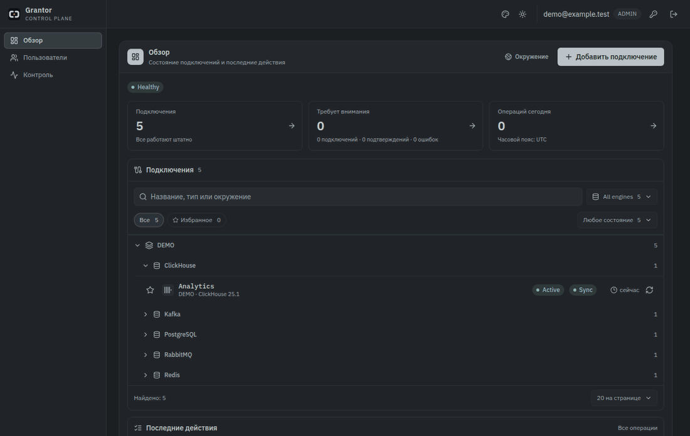
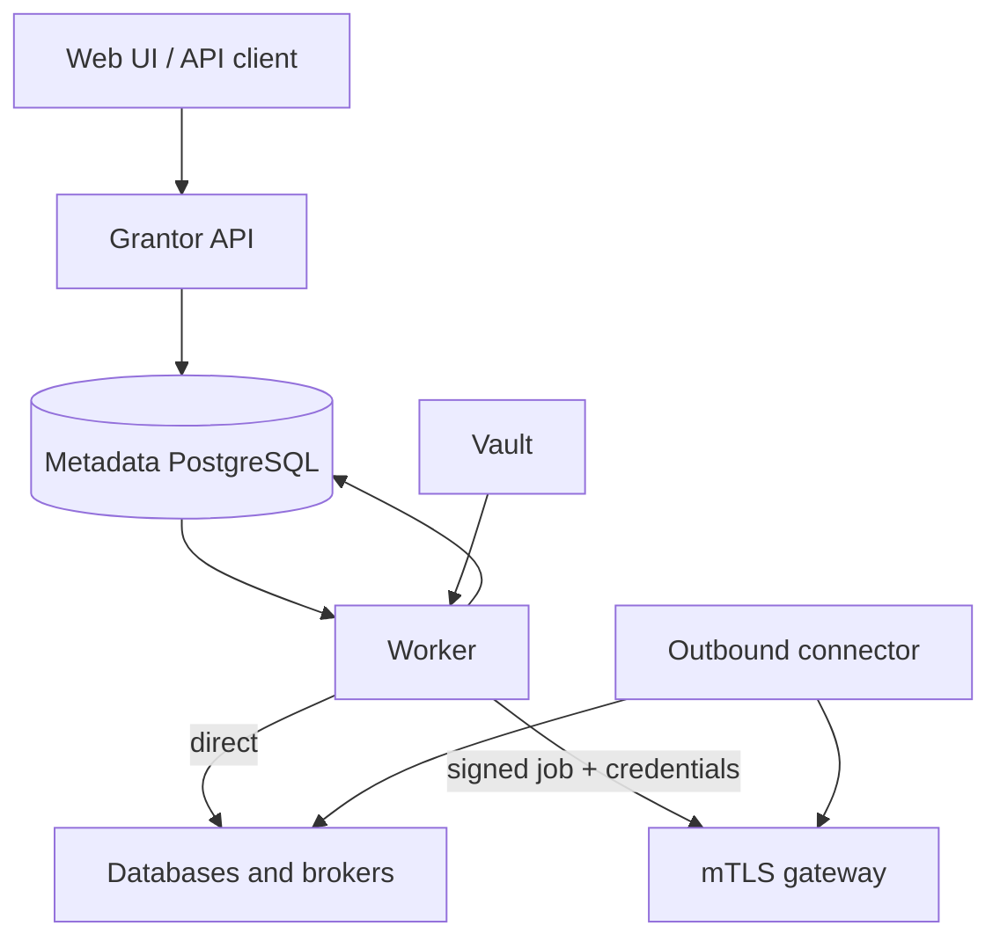

<p align="center"></p>
<h1 align="center">Grantor</h1>
<p align="center">Database and broker access, with desired state, observed state and an audit trail.</p>
<p align="center">
  
  
  
  
  
</p>

Grantor inventories databases and brokers, provisions accounts and manages access from one UI and API. It supports PostgreSQL, MongoDB, MySQL, ClickHouse, RabbitMQ, Kafka/Redpanda and Redis. Credentials stay in Vault. Work runs directly or through an outbound mTLS connector in an isolated network.

## See it in use



The recording uses the real frontend with synthetic API fixtures. It does not connect to databases or change permissions. [Static screenshot](assets/readme/screenshot.png) · [Reproduce the demo](docs/demo.md)

## Run locally

Docker with Compose is the only host prerequisite:

```sh
git clone https://github.com/ArtefactoO/grantor.git
cd grantor
make up
```

Open **http://localhost:58080** and sign in with `admin` / `grantor`. These are disposable local accounts. The stack includes metadata PostgreSQL, a target PostgreSQL, Vault, Authentik, Yopass, migrations, API, worker and web UI.

- API: `http://localhost:58082`, readiness: `/health/ready`.
- Identity provider: `http://localhost:59000`.
- Logs: `make logs`. Stop: `make down`. Data remains in Docker volumes.

The local stack binds published ports to `127.0.0.1` and uses disposable development credentials. Configure your own identity provider, TLS, Vault and target credentials for a shared deployment.

## What it keeps separate

- **Desired and observed access.** A request and its confirmed result are different records. The UI reads saved inventory rather than triggering discovery on every page load.
- **People and accounts.** A principal owns identities across connections. Each target keeps its own account, roles and capability boundaries.
- **Secrets and metadata.** Target credentials are resolved from Vault. Jobs, inventory, audit records and connector results exclude secret material.
- **Retry and completion.** Changes are serialized per connection and use idempotency keys. Unavailable targets do not become successful operations or automatic revocations.
- **Control plane and isolated networks.** A connector opens an outbound mTLS session and receives credentials for one signed job in memory. It has no Vault access.

Capabilities vary by engine. Account lifecycle and offboarding can change real target access, so review the [threat model](docs/threat-model.md) and [adapter contract](docs/adapter-security-review.md) before enabling a new environment.

## How it works



## Development

```sh
make test          # Go unit tests with the race detector
make test-integration
make web-test
make web-build
make lint
```

These commands run in Docker. Integration tests create their own disposable infrastructure. On pull requests and pushes to `main`, GitHub Actions runs Gitleaks and the lightweight CLI tests. Start **Actions → CI → Run workflow** to run Go/UI checks and container builds. The workflow does not publish images or deploy an environment.

## Documentation

Documentation is in English. Some interface labels are currently in Russian.

| Task | Guide |
| --- | --- |
| Understand the data model and trust boundaries | [Architecture](docs/architecture.md), [threat model](docs/threat-model.md) |
| Configure and develop the service | [Development](docs/development.md), [deployment](docs/deployment.md) |
| Operate the interface | [Operator guide](docs/operator-interface.md) |
| Run a connector in an isolated network | [Connector deployment](docs/connector-deployment.md) |
| Prepare Vault | [Vault provisioning](docs/vault-provisioning.md) |
| Manage PostgreSQL roles and HBA | [Access operations](docs/postgresql-access-operations.md), [readiness](docs/postgres-access-readiness.md) |
| Integrate an API client | [Connection onboarding](docs/connection-api-onboarding.md) |
| Review design decisions | [ADRs](docs/adr/) |

See [CONTRIBUTING.md](CONTRIBUTING.md) for changes and [SECURITY.md](SECURITY.md) for vulnerability reports.

## License

Original project code is licensed under the [MIT License](LICENSE). Third-party dependencies and assets retain their own licenses and notices.
